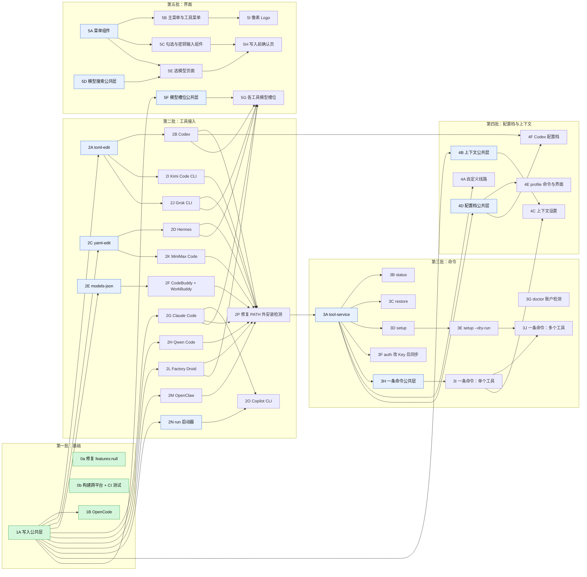

# 上游 PR 拆分计划（qiniu/coding-helper#40）

本文档说明如何把 [qiniu/coding-helper#40](https://github.com/qiniu/coding-helper/pull/40)（96 个文件，+10136 / −1374）拆成一组聚焦的小 PR 提交到上游。执行拆分的人或 agent 按本文档逐个完成即可。

## 背景

- 上游仓库：`qiniu/coding-helper`，公开仓库，没有写权限，只能从 fork `laitekin/coding-helper` 提 PR。
- PR 40 来自 fork 分支 `codex/39-upstream-cli-improvements`，只有一个提交 `2c29084`，内容等于 `laitekin/coding-helper-npm` 在 `4c407ef` 时的代码树。维护者的意见：PR 太大，要拆成聚焦的 PR；先提交公共、可复用的代码，再在它的基础上接入各个工具。
- **最终代码以 `2c29084` 为准**。拆分时从这个提交取文件，再整理成能单独编译、测试通过的中间版本。
- 上游 `main` 当前为 `9b5176a`（v0.4.0）。所有拆分分支都从上游 `main` 或上一层分支切出。

## 拆分规则

1. **公共代码单独一层**，具体工具的改动叠在它上面。例如：A 层只有写入公共层，B 层从 A 切出，只接入 OpenCode。
2. **只有一个地方用、又很小的辅助代码**（不到 100 行）跟着用它的 PR 走，不单独成层。
3. **每个 PR 只带当层用得到的代码。** 最终代码里引用了后面才加入的功能时（如模型槽位 `model-slots`、配置档 `getConnection`、上下文 `context_window`），在当层先去掉这些引用，等对应的 PR 再加回来。没有调用方的函数不提前加入。
4. **每个 PR 自带测试和文案。** 测试从最终代码的测试文件里摘出属于本层的部分，新建按主题命名的测试文件；中英文案只加本层用到的 key；README 只改本层功能对应的段落。
5. **每个 PR 都要能单独通过 `pnpm build && pnpm test`**（CI 在 Node 18 / 20 / 22 上运行）。
6. **不提交 fork 自用的改动**：`release.yml` 中发布到自定义 npm 包名的部分、`package.json` 的 `prepare` 脚本、CONTRIBUTING 中的发布说明。
7. 每个 PR 的描述写 `Refs #39`；依赖其他 PR 时写明"依赖 #xx"。PR 描述按上游的 `.github/pull_request_template.md` 填写。

## 从 fork 提交的流程

跨 fork 不支持 Stacked PR（GitHub 文档：*"Stacked pull requests require all branches to be in the same repository. Cross-fork stacks are not supported."*），也不能把 PR 的 base 设成 fork 里的分支。因此：

1. 分支推到 fork `laitekin/coding-helper`，PR 一律提到 `qiniu/coding-helper:main`。
2. **有依赖的层**：等上一层合入后，把上游 `main` 合进本层分支（合并提交，不 rebase 已推送的分支），再提 PR。这时 diff 只剩本层的改动。
3. **想提前提交时**：本层 PR 先以 `main` 为 base，描述里写"依赖 #xx，请只看最后 N 个提交"。
4. 如果维护者愿意在上游建分支承接，可以改用原生 Stacked PR，一次提交整条依赖链。
5. 依赖都已合入的 PR 可以同时提交，不需要排成一条队。

## 依赖关系图

箭头表示"必须先合入"。绿色为分支已做好、可以提交的 PR。

## PR 清单

"规模"为按最终代码估算的新增行数，实际按规则 3 删掉当层用不到的代码后通常更小。文件路径均相对仓库根目录；"测试"一列指最终代码中对应的测试用例，摘到本层新建的测试文件里。

### 第一批：基础（已完成）

| PR | 分支（fork） | 基于 | 内容 | 状态 |
|---|---|---|---|---|
| 0a | `fix/market-model-null` | `main` | `src/lib/market-model-service.ts` 对 `features` / `architecture` / `model_constraints` 做空值兜底；`tests/market-model-service.test.mjs`。+46 / −8 | 分支已推送，待提交 |
| 0b | `build/cross-platform` | `main` | `scripts/copy-locales.mjs`；`package.json` 的 build / clean 改用 Node；`.github/workflows/ci.yml` 增加测试步骤；`CLAUDE.md`。+18 / −4 | 分支已推送，待提交 |
| 1A | `feat/core-safe-write` | `main` | `src/lib/core/safe-write.ts`、`src/lib/core/state-store.ts`、`src/lib/tools/openai-compat-tool.ts`、`src/lib/wizard/flows/generic-model-selection-flow.ts`、`src/lib/config.ts`（`toolModels` / `defaultModel`，清除配置时保留备份）、`src/lib/endpoints.ts`（`isQiniuBaseUrl`）、`generic_*` 文案；`tests/safe-write.test.mjs`、`tests/openai-compat-tool.test.mjs`。+621 / −6 | 分支已推送，待提交 |
| 1B | `feat/opencode` | 1A | `src/lib/tools/opencode-tool.ts`、在 `tool-manager.ts` 和 `tools/index.ts` 注册、README；`tests/opencode-tool.test.mjs`。+243 / −3 | 分支已推送，1A 合入后提交 |

说明：

- 1A 没有包含 dry-run、"已装载"记录（`markApplied` 等）和 `writeTextOrRemove`，因为当层没有调用方，分别在 3E、3A、2A 加入。
- OpenCode 的 `unloadConfig` 在还原后会自己清除原值记录（`stateStore.markRemoved`）。原因是上游向导直接调用 `unloadConfig`，3A 之前没有 `tool-service` 负责这一步。
- fork 上的 `feat/core-opencode` 是 1A + 1B 合在一起的旧版本，已被取代，不要提交。

### 第二批：工具接入

每个接入新工具的 PR 都要包括：在 `src/lib/tool-manager.ts` 和 `src/lib/tools/index.ts` 注册、本工具的中英文案、README 中本工具的表格行和配置说明。

| PR | 基于 | 内容 | 测试 | 规模 |
|---|---|---|---|---|
| 2A | 1A | `src/lib/core/toml-edit.ts`：按行编辑 TOML，保留注释与格式；`safe-write.ts` 加 `writeTextOrRemove`（文本配置还原后为空时删除文件，TOML / YAML / .env 的工具都用） | `toml table key helpers`；`dotenv and toml helpers` 中的 TOML 部分 | ~200 |
| 2B | 2A | Codex 迁到写入公共层：`src/lib/tools/codex-tool.ts`（含非 GPT 模型目录）。去掉审查 / 子代理 / 记忆槽位（5G）和配置档 provider（4F） | `tests/codex-tool.test.mjs`；`Codex: load keeps MCP servers and unload restores…`；`Codex catalog lists non-GPT models…` | ~500 |
| 2C | 1A | `src/lib/core/yaml-edit.ts`：按行编辑 YAML，保留注释。如果比 2A 先提交，带上与 2A 完全相同的 `writeTextOrRemove` | `YAML line editing keeps comments and spacing…` | ~300 |
| 2D | 2C | Hermes 迁移：`src/lib/tools/hermes-tool.ts`。去掉看图槽位（5G） | `tests/hermes-tool.test.mjs` | ~300 |
| 2E | 1A | `src/lib/tools/models-json.ts`：CodeBuddy / WorkBuddy 共用的 models.json 读写 | `models.json (CodeBuddy / WorkBuddy) round trip…` | ~150 |
| 2F | 2E | CodeBuddy 和 WorkBuddy 迁移：`codebuddy-tool.ts`、`workbuddy-tool.ts` | 两者装载、还原逐字节一致 | ~250 |
| 2G | 1A | Claude Code 迁移：`claude-code-tool.ts`，包括切换模型时清除 `/model` 的选择。去掉兜底 / 子代理槽位（5G） | `Claude Code: unload restores values…`；`corrupt settings.json is never overwritten`；`unload leaves a config it did not write alone`；`switching models clears the /model selection…` | ~350 |
| 2H | 1A | Qwen Code：`qwen-code-tool.ts`，自带 `src/lib/core/dotenv-edit.ts`（只有它用）。如果比 2A 先提交，带上与 2A 完全相同的 `writeTextOrRemove` | `Qwen Code: key goes to ~/.qwen/.env…`；`dotenv and toml helpers` 中的 dotenv 部分 | ~200 |
| 2I | 2A | Kimi Code CLI：`kimi-code-tool.ts` | `Kimi Code CLI: provider and model alias tables…` | ~180 |
| 2J | 2A | Grok CLI：`grok-tool.ts`。去掉会话摘要槽位（5G） | `Grok CLI: [model.qiniu] plus [models] default…`；`a [models] table created by us is removed again` | ~200 |
| 2K | 2C | MiniMax Code：`minimax-code-tool.ts`，写入通过官方 `mcode provider add` | `MiniMax Code: setup calls mcode provider add…` | ~170 |
| 2L | 1A | Factory Droid：`droid-tool.ts`。去掉会话默认模型槽位（5G） | `Factory Droid: only entries prefixed "Qiniu: "…` | ~180 |
| 2M | 1A | OpenClaw：`openclaw-tool.ts` | `OpenClaw: provider + primary model…`；`JSON5 config with comments is reported, never overwritten` | ~180 |
| 2N | 1A | `run` 启动器：`base-tool.ts` 加 `launchOnly` / `getLaunchEnv`；`src/commands/run.ts`；`command.ts` 的 `run` 子命令。最终代码的 `run.ts` 用 `find-command`（2P 才加入），当层先沿用原来的命令查找方式 | 启动器只注入环境变量、不改配置文件 | ~150 |
| 2O | 2N、2G | GitHub Copilot CLI：`copilot-tool.ts`；Claude Code 实现 `getLaunchEnv` | `Copilot CLI is launch-only and builds COPILOT_* variables` | ~100 |
| 2P | 2B–2M | 修复：工具装在 PATH 之外（如 Claude Code 本地安装）时识别为未安装。`src/utils/find-command.ts`，各工具和 `OpenAICompatTool` 改用它 | `findCommand finds tools outside PATH…` | ~150 |

### 第三批：命令

| PR | 基于 | 内容 | 测试 | 规模 |
|---|---|---|---|---|
| 3A | 2P | `src/lib/core/tool-service.ts`（`applyTool` / `removeTool` / `syncAppliedTools` / `getSyncTargets` / `getRestoreTargets`）；`state-store.ts` 加"已装载"记录（`markApplied` / `getApplied` / `isApplied`）；`ITool.isConfigured`；`src/lib/tool-registry.ts`；向导的装载 / 卸载改走 `tool-service` | `stateStore` 已装载记录；`sync skips a tool the user switched to another provider…` | ~250 |
| 3B | 3A | `status` 命令（`src/commands/setup.ts` 的 `statusCommand`、`command.ts`、`commands/index.ts`） | `status --json` 输出 | ~100 |
| 3C | 3A | `restore` 命令（`restoreCommand`） | 还原有装载记录或指向七牛的工具 | ~150 |
| 3D | 3A | `setup` 批量配置（`setupCommand`，`--tools` / `--yes` / `--json` / `--key-stdin`） | `setup` 非交互流程 | ~250 |
| 3E | 3D | `setup --dry-run`：`safe-write.ts` 加 `setDryRun` / `getPlannedChanges`；`src/utils/line-diff.ts`；`wizard/ui/tool-view.ts` 的改动展示；`config.useApiKeyForSession` | `dry run records changes without touching disk` | ~200 |
| 3F | 3A | `auth` 改 Key 或线路后同步到仍指向七牛的工具（`src/commands/auth.ts`） | 同步只覆盖跟随当前连接的工具 | ~100 |
| 3G | `main` | doctor 检测账户能否调用模型：`src/commands/doctor.ts`、`api-validator.ts` 的 `checkAccountStatus` / `describeAccountStatus` | 账户状态描述 | ~80 |
| 3H | 3A | 一条命令配置的公共层：`src/lib/core/quick-args.ts`（参数解析、Key 来源）、`src/lib/core/model-mapping.ts`（一个模型到各工具配置项的映射）。去掉槽位引用 | 参数解析、模型自动选择 | ~250 |
| 3I | 3H | 一条命令配置：单个工具 + Key + 模型（`src/commands/quick.ts`、`command.ts` 默认命令）；`endpoints.ts` 支持 `CODING_HELPER_BASE_URL_CHINA` / `_INTERNATIONAL` 供测试指向本地模拟服务 | `tests/quick-command.test.mjs` 中的单工具部分 | ~350 |
| 3J | 3I、3E | 一条命令配置：多个工具 / `all` / `--json` / `--dry-run` / `--no-save` | `tests/quick-command.test.mjs` 其余部分 | ~250 |

### 第四批：配置档与上下文

| PR | 基于 | 内容 | 测试 | 规模 |
|---|---|---|---|---|
| 4A | 3A | 自定义线路：`endpoints.ts` 的 `custom`、`config.ts` 的 `base_url`、`registerCustomBaseUrls`、`wizard/flows/endpoint-selection-flow.ts` | 自定义地址被识别为七牛线路 | ~200 |
| 4B | 1A | 上下文公共层：`config.ts` 的 `context_window`、`parseContextSize`；`OpenAICompatTool` 的 `capContextWindow`，`fetchModelLimits` 按设置收窄 | `parseContextSize understands k / m…`；`context window is stored per tool…` | ~120 |
| 4C | 4B、3I | 上下文设置界面（`wizard/flows/context-flow.ts`）和 `--context` 参数 | `--context` 写入各工具 | ~250 |
| 4D | 3A | 配置档公共层：`config.ts` 的 `profiles` / `tool_profiles`、`getConnection`；`applyTool` 按工具取 Key 与地址 | `profiles: save, switch, pin a tool, remove`；`settings snapshot restores models and context exactly` | ~250 |
| 4E | 4D | `profile` 命令（`src/commands/profile.ts`）、`wizard/flows/profile-flow.ts`、`@配置档` 参数 | `profile names and @profile arguments`；`profile commands, @profile in one command…` | ~400 |
| 4F | 4D、2B | Codex 每个配置档写成一个 provider（`qnaigc-<名>`，`experimental_bearer_token`）和 `~/.codex/qn-<名>.config.toml`，不写 `[profiles.x]` | `Codex profiles: one provider per profile…` | ~200 |

### 第五批：界面

交互约定：只用方向键、回车、Esc；不加字母快捷键，底部提示也不显示字母键。

| PR | 基于 | 内容 | 测试 | 规模 |
|---|---|---|---|---|
| 5A | `main` | 菜单组件：`src/lib/wizard/ui/prompts.ts` 中的 `menuPrompt`（右侧值、打字搜索、标签页、Esc 返回）；`utils/string-width.ts`、`theme.ts`；依赖 `@inquirer/core` | 菜单按键行为 | ~350 |
| 5B | 5A | 主菜单、工具菜单改用新组件：`main-menu.ts`、`tool-menu.ts`、`prompt-helper.ts`、`ui-renderer.ts`、`wizard.ts`、`language-flow.ts` | 菜单流程 | ~400 |
| 5C | 5A | 勾选与密钥输入组件：`checkPrompt`（空格勾选，回车确认，没勾选时回车处理当前行）、`secretPrompt`（首尾 4 位掩码）、可 Esc 的文本输入与"按回车继续"；`api-key-flow.ts` 改用新组件 | `maskSecret keeps only the first and last 4 characters` | ~300 |
| 5D | `main` | 模型搜索公共层：`src/lib/core/model-search.ts`（纯函数） | `search ignores - / . and spaces`；`search understands Chinese vendor names`；`search filters by context size and vision`；`ranking: prefix match…`；`no match: closest models…` | ~250 |
| 5E | 5D、5A | 选模型页面：`wizard/flows/model-pick-flow.ts`（搜索框、厂商标签、最近使用） | `highlightMatch underlines the matched characters only`；`recent models keep the latest three` | ~300 |
| 5F | 1A | 模型槽位公共层：`src/lib/core/model-slots.ts`、`config.ts` 的 `slotModels` | `slots follow the main model unless set separately` | ~100 |
| 5G | 5F 及对应工具 | 各工具的槽位：Claude Code 兜底 / 子代理、Codex 审查 / 子代理 / 记忆、Droid 会话默认、Grok 会话摘要、Hermes 看图；`wizard/flows/model-slots-flow.ts`。超过 500 行时按工具拆 | 各工具槽位写入与还原的 5 个测试 | ~400 |
| 5H | 5C、5E | 写入前确认页：`wizard/ui/write-plan.ts`；`tool-setup-flow.ts` 的"选工具 → 选模型 → 确认" | 确认页的写入计划 | ~400 |
| 5I | 5B | 像素 Logo 和工具角色（`wizard/ui/pixel.ts`、`logo.ts`、`ui-renderer.ts` 页头）和 `docs/images/` 截图。纯外观，可选 | `every sprite is 12x10…`；`renderGrid maps pixel pairs to half blocks` | ~300 |

## 每个 PR 的操作步骤

1. 从上游 `main`（或上一层分支）切出新分支：`git switch -c <分支> <基于的提交>`。
2. 从 `2c29084` 取本层文件：`git checkout 2c29084 -- <文件>`；只取一部分的文件手工整理。
3. 按规则 3 去掉当层用不到的引用和函数，保证能编译。
4. 新建本层的测试文件，把最终代码里对应的测试摘过来；补充本层特有的回归测试。
5. 加入本层用到的中英文案，更新 README 和 `CLAUDE.md` 中对应的段落。
6. 运行 `pnpm build && pnpm test`；能装 Node 18 / 20 时分别跑一遍。
7. 审查 diff：有没有没用到的代码、文档是否和代码一致、有没有混进别的层的改动。
8. 推到 fork，在 PR 中写 `Refs #39`，有依赖时写明依赖的 PR。

## 进度

| 批次 | 数量 | 已完成 |
|---|---|---|
| 第一批 | 4 | 4（分支已推送，待提交到上游） |
| 第二批 | 16 | 0 |
| 第三批 | 10 | 0 |
| 第四批 | 6 | 0 |
| 第五批 | 9 | 0 |
| 合计 | 45 | 4 |

全部合入后，关闭 PR 40，并在 #39 中列出各个 PR。
